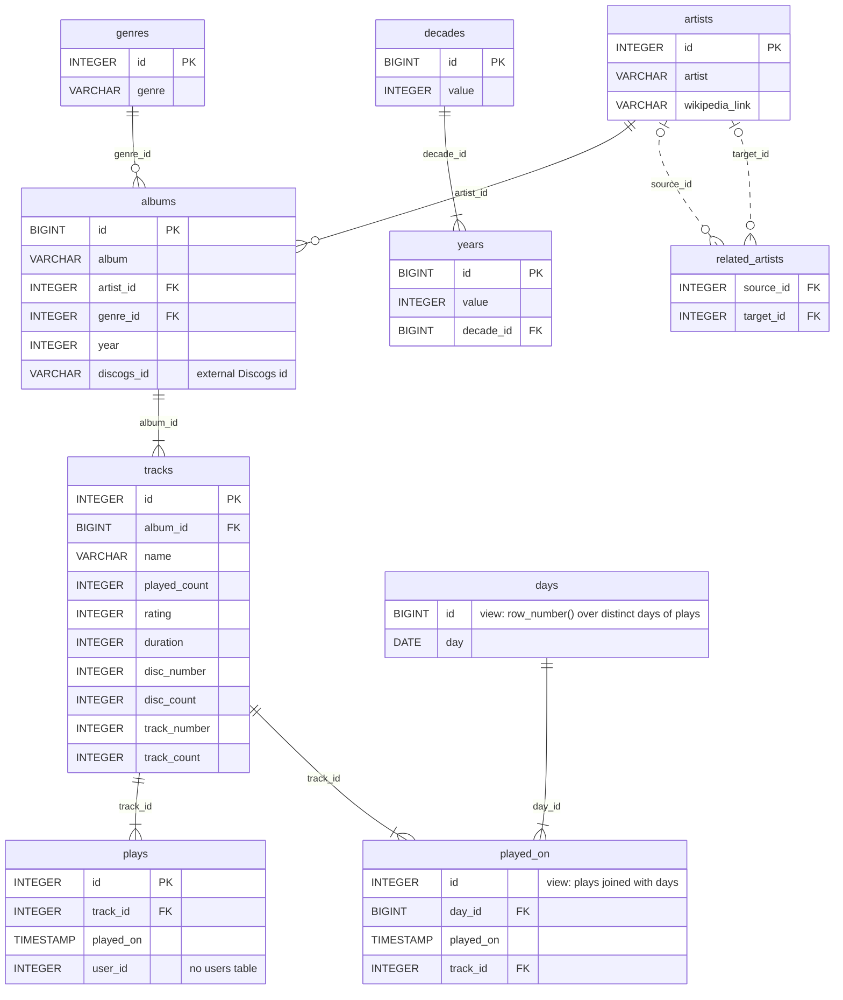

# nodes2026

## Introduction

This is a demo project for [Neo4j Virtual Graph](https://neo4j.com/product/virtual-graph/), a labeled property graph modeled atop of relational databases.

Supported databases are

* Big Query
* Clickhouse
* Databricks
* DuckDB
* Snowflake
* SQLite
* S3 Tables with Iceberg catalog

The demo uses DuckDB with my current dataset from [charts.michael-simons.eu](https://charts.michael-simons.eu/charts/2026/10) (find that software [here](https://codeberg.org/michael-simons/scrobbles4j))

I have been using this example for what it feels like forever:

* [Full relational centric](https://github.com/michael-simons/bootiful-databases), a lot about jOOQ and the background of talks such as [
  Live with your SQL-fetish and choose the right tool for the job](https://speakerdeck.com/michaelsimons/live-with-your-sql-fetish-and-choose-the-right-tool-for-the-job)
* [Bootiful music](https://github.com/michael-simons/bootiful-music), essentially the background for [Going from relational databases to databases with relations with Neo4j and Spring Data](https://speakerdeck.com/michaelsimons/going-from-relational-databases-to-databases-with-relations-with-neo4j-and-spring-data-b5522486-f2bb-4609-9a35-be54feae6702)

With Virtual Graph, I finally come full circle: No import, just mapping relational tables to a real graph instead of import and an object graph model, i.e. going from those tables:

```
┌───────────────────────────────┐
│            tracks             │
│                               │
│ id           integer not null │
│ album_id     bigint           │
│ name         varchar          │
│ played_count integer          │
│ rating       integer          │
│ duration     integer          │
│ disc_number  integer          │
│ disc_count   integer          │
│ track_number integer          │
│ track_count  integer          │
└───────────────────────────────┘

┌────────────┐
│    days    │
│            │
│ id  bigint │
│ day date   │
└────────────┘


┌──────────────────────────────┐
│          played_on           │
│                              │
│ id        integer   not null │
│ day_id    bigint             │
│ played_on timestamp          │
│ track_id  integer            │
└──────────────────────────────┘
```

towards this mapping:


```cypher
CREATE OR REPLACE VIRTUAL GRAPH DATABASE music
SET DATASOURCE {type: 'duckdb',  path: 'music.db'}
SET SECRET {type: 'anonymous'}
SET MAPPING
NODE TABLES (
  tracks LABEL Track PROPERTIES ARE ALL COLUMNS EXCEPT (id),
  people LABEL Day  PROPERTIES ARE ALL COLUMNS EXCEPT (id)
)
RELATIONSHIP TABLES (
  played_on
    KEY (track_id, day_id)
    SOURCE KEY (track_id) REFERENCES track (id)
    DESTINATION KEY (day_id) REFERENCES day (id)
    LABEL PLAYED_ON
)
```

> [!NOTE]
> Cypher / GQL syntax will be released late 2026, early 2027!

<details>
<summary>More on this below</summary>

Neo4j virtual graph is currently configured via a JSON based mapping.
This is an intermediate format, but it will be possible to use both Cypher / GQL, the intermediate format and the upcoming Ontology format with extension to configure virtual Graph.

The above schema with our intermediate format looks like this:

```json
{
  "catalog": "music",
  "schema": "main",
  "entities": {
    "nodes": [
      {
        "label": "Day",
        "table": "days",
        "key": [
          {
            "column": "id"
          }
        ],
        "properties": [
          {
            "name": "value",
            "column": "day"
          }
        ]
      },
      {
        "label": "Track",
        "table": "tracks",
        "key": [
          {
            "column": "id"
          }
        ],
        "properties": [
          {
            "name": "name",
            "column": "name"
          },
          {
            "name": "playedCount",
            "column": "played_count"
          },
          {
            "name": "rating",
            "column": "rating"
          },
          {
            "name": "duration",
            "column": "duration"
          }
        ]
      }
    ],
    "relationships": [
      {
        "label": "PLAYED_ON",
        "table": "played_on",
        "start": {
          "targetEntity": "Track",
          "keys": [
            {
              "nodeColumn": "id",
              "relationshipColumn": "track_id"
            }
          ]
        },
        "end": {
          "targetEntity": "Day",
          "keys": [
            {
              "nodeColumn": "id",
              "relationshipColumn": "day_id"
            }
          ]
        },
        "key": [
          {
            "column": "track_id"
          },
          {
            "column": "day_id"
          }
        ],
        "properties": [
          {
            "name": "playedOn",
            "column": "played_on"
          }
        ]
      }
    ]
  }
}
```
</details>

## Virtual Graph Setup

As of writing, three files are required:

* [`datasource.json`](datasource.json) containing connection information for the target database (here: DuckDB)
* [`secret.json`](secret.json) containing a secret to connect to the target database (here: an anonymous secret)
* [`schema.json`](schema.json) containing the mapping (the full version of the excerpt above)

Virtual Graph also needs the JDBC driver for the target database (here, DuckDB JDBC).

This setup can be started with [`start_neo4j.sh`](start_neo4j.sh). The script will download the JDBC driver if necessary. 

Neo4j Browser can be reached as per usual via [localhost:7474](http://localhost:7474) or via any driver on Port 7687. The recommend.sh script uses Cypher-Shell to connect.

If you populate the music database yourself, I recommend skipping upgrading the worktree index like this:

```bash
git update-index --skip-worktree music.db
```

Which can be undone via

```bash
git update-index --no-skip-worktree music.db
```

## Graph Queries

The queries have been developed using Claude Code CLI with Opus 5.5. Prose and queries have all been reviewed. The `recommend.sh` script sources all queries from [queries.md](queries.md).

My recommendations in late 2026 for the track "Angst frisst Seele auf" bei "Feine Sahne Fischfilet" are pretty neat and accurate:

| bestScore | artist                    | recommendations                                                                                                                             | reason            |
|----------:|---------------------------|---------------------------------------------------------------------------------------------------------------------------------------------|-------------------|
|    1508.9 | Die Ärzte                 | Living Hell; Allein; Tu das nicht                                                                                                           | genre Punk        |
|    1154.2 | Antilopen Gang            | Enkeltrick [mit Campino / ZK]; Beate Zschäpe hört U2 [mit Jan Windmeier / Turbostaat]; Fick die Uni [mit Cecilia Boström / The Baboon Show] | genre Punk        |
|     629.1 | Die Toten Hosen           | Eine handvoll Erde; Wie viele Jahre (Hasta La Muerte); Herz brennt                                                                          | related artist    |
|     583.3 | Feine Sahne Fischfilet    | Ich glaube dir; Glitzer im Gesicht; Solange es brennt                                                                                       | artist in cluster |
|     462.8 | Turbonegro                | Are You Ready (For Some Darkness); Don't Say Motherfucker, Motherfucker; Zillion Dollar Sadist                                              | genre Punk        |
|     295.8 | Green Day                 | Give Me Novacaine; Boulevard Of Broken Dreams; Basket Case                                                                                  | genre Punk        |
|     278.9 | The Offspring             | Self Esteem; Come Out And Play; What Happened To You?                                                                                       | genre Punk        |
|     264.9 | Smoke Blow                | Iron In My Soul; Unbroken; Black Church Of America                                                                                          | genre Punk        |
|     184.1 | Ramones                   | Pet Sematary; Punishment Fits The Crime; Learn To Listen                                                                                    | genre Punk        |
|     166.5 | Guns n' Roses             | You Can't Put Your Arms Around A Memory; Buick Makane; Ain't It Fun                                                                         | genre Punk        |
|     161.3 | Dropkick Murphys          | The Green Fields Of France; The Burden; Citizen C.I.A.                                                                                      | genre Punk        |
|     150.6 | Die Kassierer             | Meister aller ______; Du hast geguckt; Das schlimmste ist, wenn das Bier alle ist                                                           | genre Punk        |
|     144.1 | Joey Ramone               | What A Wonderful World; Like A Drug I Never Did Before; Venting                                                                             | genre Punk        |
|     119.6 | Wizo                      | Ganz klar gegen Nazis; Unpoliddisch; Kriminell & Asozial                                                                                    | genre Punk        |
|     114.2 | Abwärts                   | Computerstaat 2048; Das Rundum-Glückspaket; Guten Morgen, Gott                                                                              | genre Punk        |
|     113.6 | Nick Cave & The Bad Seeds | In The Ghetto; Wings Off Flies; Saint Huck                                                                                                  | genre Punk        |
|     105.7 | Slime                     | Unsere Lieder; Patrioten; Viva la Muerte                                                                                                    | genre Punk        |
|      97.0 | Soilent Grün              | Sodomie; FDJ Punks; Romantik                                                                                                                | genre Punk        |
|      87.1 | S.U.M.P.                  | The Final Countdown; Opel-Gang; Sun City                                                                                                    | genre Punk        |
|      82.7 | ZSK                       | Antifascista; Hallo Hoffnung; Es müsste immer Musik da sein                                                                                 | genre Punk        |

## Relational schema

The DuckDB database `music.db` is the source of the virtual graph.



There's an empty database in this repository, but you can also create one yourself:

```sql
CREATE TABLE albums(id BIGINT, album VARCHAR, artist_id INTEGER, genre_id INTEGER, "year" INTEGER, discogs_id VARCHAR, PRIMARY KEY(id));
CREATE TABLE artists(id INTEGER, artist VARCHAR, wikipedia_link VARCHAR, PRIMARY KEY(id));
CREATE TABLE "decades"(id BIGINT, "value" INTEGER, PRIMARY KEY(id));
CREATE TABLE genres(id INTEGER, genre VARCHAR, PRIMARY KEY(id));
CREATE TABLE plays(id INTEGER, track_id INTEGER, played_on TIMESTAMP, user_id INTEGER, PRIMARY KEY(id));
CREATE TABLE related_artists(source_id INTEGER, target_id INTEGER);
CREATE TABLE tracks(id INTEGER, album_id BIGINT, "name" VARCHAR, played_count INTEGER, rating INTEGER, duration INTEGER, disc_number INTEGER, disc_count INTEGER, track_number INTEGER, track_count INTEGER, PRIMARY KEY(id));
CREATE TABLE "years"(id BIGINT, "value" INTEGER, decade_id BIGINT, PRIMARY KEY(id));
CREATE VIEW "days" AS SELECT row_number() OVER (ORDER BY "day") AS id, "day" FROM (SELECT DISTINCT CAST(played_on AS DATE) AS "day" FROM plays);
CREATE VIEW played_on AS SELECT plays.id, "days".id AS day_id, played_on, track_id FROM plays INNER JOIN "days" ON (("day" = CAST(played_on AS DATE)));
```
